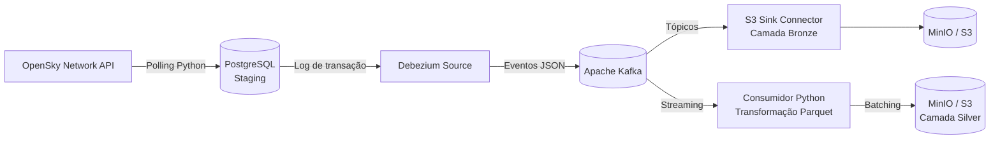

# ✈️ OpenSky CDC DataLake

<p align="center">
  
  
  
</p>

<p align="center">
  
</p>

<p align="center">
  
</p>

<p align="center">
  <i>Cobertura de sensores da OpenSky Network ao redor do mundo</i>
</p>

---

## 📑 Sumário

- [Descrição do Projeto](#-descrição-do-projeto)
- [Arquitetura](#-arquitetura)
- [Tecnologias Utilizadas](#-tecnologias-utilizadas)
- [Estrutura do Projeto](#-estrutura-do-projeto)
- [Como Executar](#-como-executar)
- [Roadmap de Desenvolvimento](#-roadmap-de-desenvolvimento)
- [Créditos e Inspiração](#-créditos-e-inspiração)

---

## 📖 Descrição do Projeto

O **OpenSky CDC DataLake** é um projeto de Engenharia de Dados voltado para a captura e replicação de dados de tráfego aéreo em tempo real utilizando a técnica de **Change Data Capture (CDC)**. 

O pipeline extrai os estados dinâmicos (posição, altitude, velocidade) dos aviões na [OpenSky Network](https://opensky-network.org/), armazena as fotos do momento (snapshots) em um banco transacional PostgreSQL e utiliza o **Debezium** para rastrear essas alterações, despachando-as para um cluster **Kafka**. No final, uma aplicação Python atua como consumidora para higienizar e salvar as mensagens na camada Silver de um **Data Lake (MinIO)** utilizando o formato otimizado colunar **Parquet**.

> ℹ️ **Nota conceitual:** A API da OpenSky não expõe um changelog nativo — ela retorna o estado atual das aeronaves a cada consulta. Por isso, o CDC deste projeto atua sobre a camada de staging em PostgreSQL. As mudanças inseridas e atualizadas no banco são o gatilho para o stream de eventos.

---

## 🏗️ Arquitetura

O ecossistema é orquestrado de ponta a ponta e segmentado em zonas claras de ingestão, roteamento e armazenamento analítico.



## 🛠️ Tecnologias Utilizadas

| Camada | Tecnologia | Papel |
|---|---|---|
| **Fonte de dados** | OpenSky Network API | Fornece o estado atual global das aeronaves |
| **Staging** | PostgreSQL | Armazena a carga e atualizações de estado |
| **CDC** | Debezium | Detecta inserções/atualizações nativamente no PostgreSQL |
| **Streaming** | Apache Kafka | Message broker que trafega os eventos de mudança |
| **Roteamento** | Kafka Connect | Despacha mensagens cruas para o Data Lake (S3 Sink) |
| **Processamento** | Python + Pandas/Pyarrow | Consome tópicos, filtra `NaN` e gera `.parquet` particionados |
| **Data Lake** | MinIO (Object Storage) | Armazena camadas Bronze (JSON) e Silver (Parquet) |
| **Infraestrutura** | Docker Compose | Orquestra todos os contêineres e redes (CDC Network) |

---

## 📁 Estrutura do Projeto

Para garantir manutenibilidade e separação de responsabilidades, o repositório foi modularizado:

```text
├── app-ingestion/            # Script Python para carga inicial e polling da API -> PostgreSQL
├── app-python/               # Serviço consumidor Python (Kafka -> Processamento -> MinIO Parquet)
├── kafka-connect/            # Configurações declarativas JSON do Debezium e MinIO S3 Sink
├── docs/                     # Recursos gráficos da documentação
└── docker-compose.yaml       # Manifesto de infraestrutura local
```

---

## ▶️ Como Executar

### Pré-requisitos
* Docker e Docker Compose instalados.
* Python 3.9+ e `pipenv` (ou venv) instalados localmente.

### 1. Subir a Infraestrutura
Clone o repositório e suba os contêineres principais (Kafka, Zookeeper, Postgres, MinIO, e a App Python):
```bash
git clone https://github.com/rafaelladuarte/opensky-cdc-datalake.git
cd opensky-cdc-datalake

docker compose up -d --build
```
> Aguarde cerca de 1 minuto para que o cluster Kafka e o Kafka Connect inicializem completamente.

### 2. Registrar os Conectores do Kafka
Precisamos avisar ao Kafka Connect para iniciar a leitura do Postgres (Source) e a escrita bruta no MinIO (Sink):
```bash
# Registrar Conector do Debezium (Postgres -> Kafka)
jq '{name: "opensky-postgres-connector", config: .}' kafka-connect/source-postgres.json > tmp_source.json
curl -s -X POST -H "Content-Type: application/json" --data @tmp_source.json http://localhost:8083/connectors

# Registrar Conector S3 (Kafka -> MinIO Bronze)
jq '{name: "opensky-minio-connector", config: .}' kafka-connect/sink-minio.json > tmp_sink.json
curl -s -X POST -H "Content-Type: application/json" --data @tmp_sink.json http://localhost:8083/connectors

# (Você pode apagar os arquivos tmp_.json logo após)
rm tmp_*.json
```

### 3. Executar o Coletor de Dados
Neste momento, a arquitetura está rodando e escutando. Basta injetarmos os dados para o CDC agir!
Abra outro terminal, prepare o ambiente Python e rode o script da API:
```bash
cd app-ingestion
pipenv install
pipenv run python insert_data_postgres.py
```
*(O script buscará >10.000 registros na API e atualizará o PostgreSQL).*

### 4. Validar os Resultados
* **Monitorar Mensagens (Kafka UI):** Acesse [http://localhost:8080](http://localhost:8080) e vá até os `Topics`.
* **Visualizar o Data Lake (MinIO):** Acesse [http://localhost:9001](http://localhost:9001) (User: `admin` / Pass: `minioadmin`). 
  - Na pasta `topics/` estará sua camada Bronze (arquivos JSON brutos).
  - Na pasta `silver/opensky/` estarão seus arquivos estruturados particionados por data (`.parquet`), gerados automaticamente pelo contêiner `app-python`!

---

## 🗺️ Roadmap de Desenvolvimento

- [x] Configuração da rede Docker e serviços base (PostgreSQL, Kafka, Zookeeper, MinIO).
- [x] Criação da aplicação de ingestão base (`app-ingestion`) com conexão real com a OpenSky API.
- [x] Configuração do conector Source do Debezium para escutar a tabela de staging.
- [x] Configuração do conector Sink S3 para gravação na camada Bronze.
- [x] Desenvolvimento de consumidor assíncrono em Python com Pandas/Pyarrow.
- [x] Deploy da camada Silver (conversão inteligente de Payload JSON para Parquet).
- [ ] *(Próximos Passos)* Adicionar Apache Iceberg + Trino para consultas SQL nativas no DataLake.
- [ ] *(Próximos Passos)* Criar Dashboards no Apache Superset apontando para a camada Ouro/Silver.

---

## 🙏 Créditos e Inspiração

Este projeto baseia-se na arquitetura ensinada no minicurso **["Replicando Informações em Realtime para o DataLake utilizando CDC"](https://github.com/Labdata-FIA/fia-vestival-cdc-lake)**, ministrado no Festival de Verão da **FIA LabData**. Os dados utilizados são fornecidos livremente pela **[OpenSky Network](https://opensky-network.org/)**, rede colaborativa de sensores ADS-B voltada para pesquisa global.

## 👩‍💻 Autor

Desenvolvido por **Rafaella Duarte**.