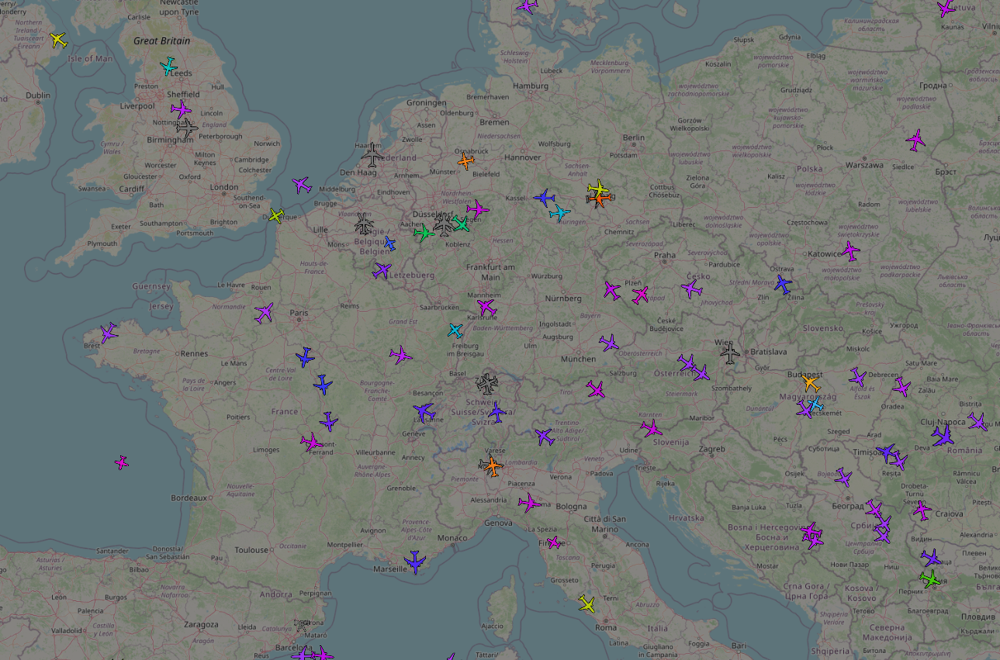
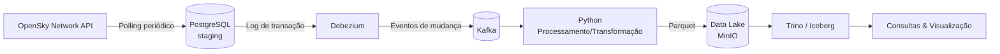

# ✈️ OpenSky CDC DataLake

<p align="center">
  
  
  
</p>

<p align="center">
  
</p>

<p align="center">
  
</p>

<p align="center">
  <i>Cobertura de sensores da OpenSky Network ao redor do mundo</i>
</p>

---

## 📑 Sumário

- [Descrição do Projeto](#-descrição-do-projeto)
- [Objetivo](#-objetivo)
- [Arquitetura](#-arquitetura)
- [Tecnologias Utilizadas](#-tecnologias-utilizadas)
- [Estrutura do Pipeline](#-estrutura-do-pipeline)
- [Como Executar](#-como-executar)
- [Roadmap](#-roadmap)
- [Créditos e Inspiração](#-créditos-e-inspiração)
- [Autor](#-autor)

---

## 📖 Descrição do Projeto

O **OpenSky CDC DataLake** é um projeto de estudo voltado para a captura e replicação de dados de tráfego aéreo em tempo real. Utilizando **Change Data Capture (CDC)**, o objetivo é ingerir os dados de voos da [OpenSky Network](https://opensky-network.org/) e persistí-los em um Data Lake para análise posterior.

A arquitetura tem como base o repositório [fia-vestival-cdc-lake](https://github.com/Labdata-FIA/fia-vestival-cdc-lake), material do minicurso **"Hands-on - Replicando Informações em Realtime para o DataLake utilizando CDC"**, do Festival de Verão da **FIA LabData**. A diferença central deste projeto é a substituição do dataset de exemplo do curso por uma fonte de dados real, de alta frequência de atualização e alta cardinalidade: o tráfego aéreo global reportado pela OpenSky.

> ℹ️ **Nota conceitual:** a API da OpenSky não expõe um changelog nativo — ela retorna o estado atual das aeronaves a cada consulta. Por isso, o CDC deste projeto não atua diretamente sobre a API, e sim sobre a camada de staging em PostgreSQL: os snapshots de estado são gravados nessa tabela, e é sobre as mudanças *nela* que o Debezium atua.

## 🎯 Objetivo

Demonstrar, na prática, o uso de **CDC para ingestão de dados de fluxo contínuo**, garantindo armazenamento eficiente e permitindo análises avançadas sobre padrões de tráfego aéreo. O pipeline cobre:

- **Captura de dados** da OpenSky Network via polling periódico.
- **Armazenamento temporário (staging)** em PostgreSQL.
- **Captura e replicação de mudanças** usando Debezium e Kafka.
- **Processamento e transformação** dos eventos com Python.
- **Persistência** no Data Lake em formato Parquet (via MinIO).
- **Consultas analíticas otimizadas** via Trino/Iceberg.

## 🏗️ Arquitetura



**Chave de identificação:** cada aeronave é rastreada pelo seu código `icao24`. Mudanças relevantes de estado (posição, altitude, velocidade, squawk) geram eventos que trafegam por todo o pipeline até o Data Lake.

## 🛠️ Tecnologias Utilizadas

| Camada | Tecnologia | Papel |
|---|---|---|
| Fonte de dados | OpenSky Network API | Fornece estado das aeronaves em tempo real |
| Staging | PostgreSQL | Armazena o snapshot mais recente do estado |
| CDC | Debezium | Detecta inserções/atualizações no PostgreSQL |
| Streaming | Kafka | Transmite os eventos de mudança |
| Processamento | Python | Formata, valida e otimiza os dados |
| Data Lake | MinIO (Parquet) | Armazenamento otimizado e escalável |
| Query Engine | Trino + Iceberg | Consultas SQL sobre o Data Lake |
| Infraestrutura | Docker / Docker Compose | Orquestração do ambiente local |

## 🔄 Estrutura do Pipeline

1. **Coleta de Dados**
   - A API da OpenSky Network é consultada periodicamente para obter o estado atual das aeronaves.
   - Os dados são gravados/atualizados em uma tabela de staging no PostgreSQL.

2. **CDC e Streaming**
   - O Debezium monitora o log de transações do PostgreSQL e detecta inserções e atualizações.
   - O Kafka transmite esses eventos de mudança para o restante do pipeline.

3. **Processamento e Transformação**
   - Um consumidor Python lê os eventos do Kafka, aplica validações e transformações.
   - Os dados processados são escritos no Data Lake em formato Parquet.

4. **Consulta e Visualização**
   - O Trino, com catálogo Iceberg, permite consultas SQL diretamente sobre os arquivos Parquet.
   - Essas consultas alimentam análises de tráfego aéreo, rotas e padrões de voo.

## ▶️ Como Executar

> ⚠️ Seção em construção — os comandos abaixo serão detalhados conforme o desenvolvimento avança.

```bash
# Clonar o repositório
git clone https://github.com/seu-usuario/opensky-cdc-datalake.git
cd opensky-cdc-datalake

# Subir a infraestrutura local (Postgres, Kafka, Debezium, MinIO, Trino)
docker compose up -d

# Executar o coletor de dados da OpenSky
python src/collector/opensky_collector.py
```

## 🗺️ Roadmap

- [ ] Configurar ambiente Docker (PostgreSQL, Kafka, Debezium, MinIO, Trino)
- [ ] Implementar coletor da API OpenSky com polling configurável
- [ ] Configurar conector Debezium para a tabela de staging
- [ ] Implementar consumidor Kafka em Python com escrita em Parquet
- [ ] Criar tabelas Iceberg e views de consulta no Trino
- [ ] Construir dashboard/visualização de tráfego aéreo
- [ ] Documentar decisões de arquitetura e testes de carga

## 🙏 Créditos e Inspiração

Este projeto adapta a arquitetura ensinada no minicurso **["Replicando Informações em Realtime para o DataLake utilizando CDC"](https://github.com/Labdata-FIA/fia-vestival-cdc-lake)**, ministrado no Festival de Verão da **FIA LabData**. Os dados utilizados são fornecidos pela **[OpenSky Network](https://opensky-network.org/)**, rede colaborativa de sensores ADS-B para pesquisa.

## 👩‍💻 Autor

Desenvolvido por **Rafaella Duarte**.